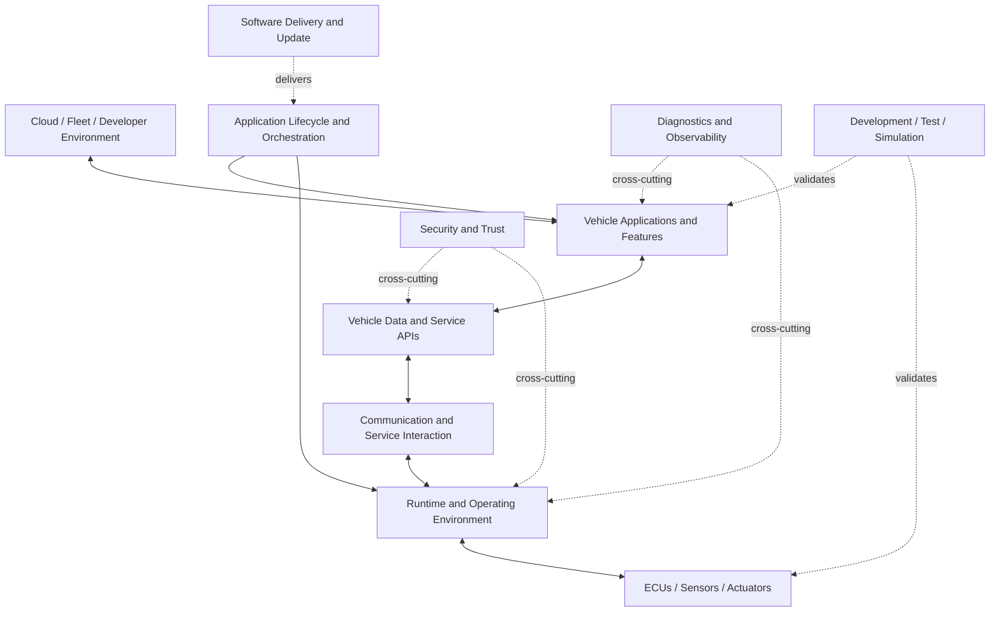

- RFC Title: Eclipse SDV Reference Vehicle Architecture and Capability Map
- Submission Date: 2026-09-01
- RFC PR: (replace with the pull request URL)
- Follow-on Actions: Define and maintain the reference architecture, capability map, and practical example after RFC acceptance

# Summary
[summary]: #summary

This RFC proposes that the Eclipse SDV WG TAC create and maintain a simple, capability-first **Reference Vehicle Architecture** that provides a common technical context for the Eclipse SDV project ecosystem. Every Eclipse SDV project in Working Group purview should be mapped to one or more capabilities in that architecture, including its primary role, relevant interfaces, and integration points. The architecture should be grounded by one intentionally small and practical end-to-end example — a "Hello Vehicle" scenario — so that the TAC can discuss projects not only individually, but as parts of a coherent software-defined vehicle system.

# Motivation
[motivation]: #motivation

The Eclipse SDV Working Group contains projects that address different parts of the software-defined vehicle stack: operating environments, middleware, communication, vehicle data, service APIs, orchestration, diagnostics, software lifecycle, testing, simulation, tooling, and other capabilities.

Today it is much easier to explain what an individual project does than to answer the broader architectural questions:

- Where does this project fit into a vehicle architecture?
- Which capability does it provide?
- Which other Eclipse SDV projects does it naturally interact with?
- Where do projects intentionally overlap or offer alternative implementations?
- Which capabilities are not yet covered by the Eclipse SDV ecosystem?
- Which interfaces are important for interoperability between projects?
- Which combinations of projects could form meaningful end-to-end demonstrations or Blueprints?

Without a shared architecture, TAC discussions can become project-centric rather than system-centric. This makes it harder to build a coherent technical roadmap for the Working Group and harder for new contributors, adopters, project leads, and Steering Committee members to understand how the portfolio fits together.

The goal of this RFC is not to define an OEM production E/E architecture, mandate a single technology stack, or create a new specification. The goal is to provide a **common architectural frame of reference** for the TAC.

The architecture must therefore be:

- simple enough to explain on one page;
- capability-oriented rather than project-oriented;
- neutral where multiple projects address similar problems;
- useful for both virtual and hardware-based vehicle setups;
- practical enough to demonstrate with a small end-to-end example;
- extensible as new projects and capabilities enter the Working Group.

A practical reference example is important because architecture diagrams alone can easily become abstract. The example should force the architecture to answer concrete questions about data flow, service interaction, deployment, runtime, diagnostics, testing, and integration boundaries.

# Stakeholder impact
[stakeholder-impact]: #stakeholder-impact

If adopted, the Reference Vehicle Architecture becomes a shared technical communication and coordination artifact for the TAC.

## TAC members

TAC members can use the architecture to discuss the Working Group as a system rather than as a list of projects. New project discussions, roadmap topics, integration proposals, and technical gaps can be placed into a common context.

Instead of asking only:

> What does Project X do?

The TAC should also be able to ask:

> Which architectural capability does Project X provide, what does it interact with, and what changes in the ecosystem if it is added, removed, or combined with another project?

## Eclipse SDV project teams

Project teams should be able to identify their project's role in the architecture and validate that the TAC's description of their capabilities is accurate.

A project may map to multiple capabilities. Multiple projects may also map to the same capability. Such overlap is not automatically a problem and should not be interpreted as a ranking or consolidation decision.

The mapping should make clear:

- the project's primary capabilities;
- relevant secondary capabilities;
- important interfaces or dependencies;
- known integration points with other projects;
- what the project intentionally does **not** provide.

## New projects

Projects seeking inclusion in the Eclipse SDV Working Group purview can use the architecture to explain where they fit and what capability they add, complement, or overlap with.

This does not replace the formal purview evaluation or any Eclipse Foundation process. It provides additional technical context for that evaluation.

## Steering Committee and broader community

The architecture provides a compact view of how the Eclipse SDV project portfolio contributes to a complete software-defined vehicle story. It should make technical gaps, collaboration opportunities, and areas of overlap easier to understand without requiring detailed knowledge of every project.

# Detailed proposal
[detailed-proposal]: #detailed-proposal

## 1. Create a capability-first Reference Vehicle Architecture

The TAC should create a logical reference architecture for a software-defined vehicle. It should describe **capabilities and interfaces first**, and map projects onto those capabilities second.

The architecture is not intended to prescribe ECU topology, hardware partitioning, AUTOSAR usage, safety architecture, or a specific OEM implementation.

An initial capability structure could include areas such as:

1. **Vehicle I/O and ECU interaction** — sensors, actuators, controllers, and low-level vehicle access.
2. **Operating environment and execution** — operating systems, runtimes, containers, processes, and execution environments.
3. **Communication and service interaction** — service-to-service communication, messaging, discovery, routing, and transport abstraction.
4. **Vehicle data and service APIs** — vehicle signals, data access, service APIs, models, and abstraction from underlying vehicle networks.
5. **Application lifecycle and orchestration** — desired state, deployment, start/stop, dependency handling, workload placement, and lifecycle management.
6. **Diagnostics and observability** — diagnostics, health information, logging, tracing, metrics, and serviceability.
7. **Software delivery and update** — packaging, distribution, installation, update, and rollback-related capabilities.
8. **Security and trust** — identity, authentication, authorization, integrity, policy enforcement, and other cross-cutting security capabilities.
9. **Development, test, simulation, and integration** — virtual environments, test orchestration, simulation, CI integration, and hardware/virtual test setups.
10. **Vehicle-to-cloud and fleet interaction** — interaction with external systems when relevant to the in-vehicle software lifecycle or application behavior.

These categories are intentionally a starting point. The TAC should refine them based on project feedback and practical use.

## 2. Keep the architecture project-neutral

The architecture should not be drawn as a stack of project logos. The capability model should exist independently of the projects that currently implement parts of it.

A conceptual view could look like this:

The final model may use different terminology or structure. The important principle is that projects are mapped **onto** a capability architecture rather than defining the architecture themselves.

## 3. Create an Eclipse SDV project capability map

For every Eclipse SDV project in Working Group purview, the TAC should maintain a compact mapping such as:

| Project | Primary capabilities | Secondary capabilities | Important interfaces | Example role in the reference architecture | Integration evidence |
| --- | --- | --- | --- | --- | --- |
| Project X | Capability A | Capability B | API / protocol / artifact | What it contributes | Blueprint, demo, test, documentation, or known integration |

The mapping should answer "what capability does this project contribute?" rather than attempt to summarize the entire project.

The mapping should also allow:

- multiple projects per capability;
- one project across multiple capabilities;
- alternative implementations;
- complementary projects;
- explicit gaps where no Eclipse SDV project currently provides a capability.

Project maintainers should be invited to review and correct their mapping.

The capability map must not be treated as a maturity ranking or project score. If the TAC wants to evaluate maturity, adoption, or project health, that should remain a separate concern.

## 4. Define one small practical "Hello Vehicle" example

The architecture should be validated through one deliberately small end-to-end scenario. The scenario should be simple enough to understand in approximately ten minutes and simple enough to implement first in a virtual environment.

A possible starting scenario is a **Cabin Comfort Loop**:

1. A simulated or physical vehicle endpoint provides cabin temperature and a simple vehicle state such as occupancy or door state.
2. A vehicle application reads those values through the appropriate vehicle data/service abstraction.
3. The application evaluates a trivial rule.
4. The application sends a command to a simple actuator such as a fan, indicator, or window abstraction.
5. The application can be deployed, started, stopped, or updated through the lifecycle/orchestration capability.
6. The application and endpoint expose enough health or diagnostic information to demonstrate serviceability.
7. The same functional flow can be exercised in a virtual test setup, with hardware being optional rather than required.

The exact use case is less important than the architectural coverage. It should be intentionally boring from a feature perspective and useful from an integration perspective.

The practical example should make it possible to walk through the architecture and ask:

- Where does the signal originate?
- How is vehicle state represented?
- How does the application access it?
- How do services communicate?
- Where does the application run?
- How is it deployed and controlled?
- How is the system diagnosed or observed?
- How is the behavior tested virtually?
- Which Eclipse SDV projects can provide each capability?
- Which interfaces connect those projects?

Not every Eclipse SDV project needs to participate in the practical example. Every project should, however, be placeable in the broader architecture.

## 5. Use the architecture to identify gaps and overlaps

Once projects are mapped, the TAC should be able to derive two useful views:

### Capability gaps

Capabilities required by the reference architecture for which there is currently no clear Eclipse SDV project coverage.

A gap is not automatically a request to create a new project. It is an input to roadmap and ecosystem discussion.

### Capability overlaps

Capabilities for which multiple projects provide related or alternative solutions.

An overlap is not automatically duplication and should not imply consolidation. The architecture should instead make the relationship explicit so that the TAC can understand whether projects are:

- complementary;
- alternative implementations;
- operating at different abstraction layers;
- targeting different deployment environments;
- candidates for stronger interoperability.

## 6. Define a small set of maintained artifacts

The follow-on work should produce at least:

- a one-page logical Reference Vehicle Architecture diagram;
- a capability glossary;
- a project-to-capability mapping;
- the practical "Hello Vehicle" walkthrough;
- a list of identified capability gaps and significant overlaps;
- links to integration examples, Blueprints, tests, or demonstrations where they exist.

Where practical, the project-to-capability mapping should eventually be stored in a machine-readable form in addition to the human-readable documentation. This would allow the same information to feed diagrams, the Eclipse SDV Landscape, project pages, or other tooling without maintaining several independent datasets.

## 7. Governance and ownership

The Reference Vehicle Architecture should be treated as a TAC coordination artifact, not as a specification imposed on Eclipse projects.

The TAC is responsible for the overall architecture model and capability taxonomy. Project teams remain responsible for their own technical architecture and implementation decisions.

Changes to a project's capability mapping should be reviewed with the relevant project maintainers where possible. Significant changes to the overall architecture or its purpose may require a follow-on RFC, while routine mapping and documentation updates can use normal pull requests.

This RFC does not transfer authority from Eclipse projects, PMCs, the Steering Committee, or any other governing body. It gives the TAC a shared technical artifact to support its roadmap, coordination, and advisory work.

## 8. Initial completion criteria

The first version should be considered useful when:

- the architecture fits on one understandable page;
- the major capabilities have short, unambiguous definitions;
- every current Eclipse SDV project in Working Group purview can be mapped to at least one capability or explicitly marked as not fitting the current model;
- project maintainers have had an opportunity to validate their mapping;
- the practical example can be explained end-to-end using the architecture;
- known gaps and overlaps can be identified without turning the artifact into a project ranking;
- the model works for virtual-first setups and does not require a specific hardware platform.

# Drawbacks
[drawbacks]: #drawbacks

A simplified architecture can create the impression that automotive software systems are simpler than they really are. A one-page architecture necessarily leaves out important concerns such as detailed functional safety decomposition, real-time constraints, hardware topology, networking, safety/security partitioning, and OEM-specific design choices.

Mapping projects into an architecture can also become politically sensitive if the map is interpreted as a recommendation, ranking, or statement that one project replaces another. The architecture must therefore remain capability-first and explicitly support multiple implementations for the same capability.

The artifact can become stale if it is not maintained as projects evolve. It therefore needs lightweight ownership and project-maintainer review rather than a one-time TAC exercise.

There is also a risk of spending too much time perfecting taxonomy instead of improving integration. The practical example and one-page constraint are intended to keep the effort grounded.

# Rationale and alternatives
[rationale-and-alternatives]: #rationale-and-alternatives

## Why this proposal

The TAC needs an architectural tool that sits between two extremes:

- a high-level catalog of projects, which shows what exists but not how the pieces relate; and
- a complete production vehicle architecture, which would be too complex, too OEM-specific, and outside the purpose of the Working Group.

A capability-first reference architecture provides enough structure to coordinate the ecosystem while remaining technology-neutral and understandable.

## Alternative: Maintain only a project catalog

A project catalog or landscape is useful for discovery, but it does not adequately show runtime relationships, capability boundaries, interfaces, overlaps, or missing parts of an end-to-end system.

The capability architecture should complement, not replace, such a catalog.

## Alternative: Build the architecture directly from project logos

This would be easy to create but would make the architecture depend on the current project portfolio. It would also make overlaps difficult to represent and could unintentionally turn the picture into a recommended stack.

Capabilities should therefore be defined independently and projects mapped afterward.

## Alternative: Define a complete production E/E architecture

A production-grade E/E architecture would require hardware topology, safety concepts, network design, timing constraints, redundancy, security zones, and many other OEM-specific decisions. That would make the artifact harder to agree on and less useful as a simple TAC coordination tool.

## Alternative: Use only existing Blueprints or demonstrations

Blueprints and demonstrations are valuable integration evidence, but each one represents a selected combination of projects and a particular use case. They do not by themselves provide a neutral view of the entire capability landscape.

The Reference Vehicle Architecture can instead provide the frame in which multiple Blueprints and demonstrations are placed.

## Impact of doing nothing

Without a shared capability model, the Working Group risks continuing to discuss projects largely in isolation. This makes technical gaps and integration opportunities harder to identify and makes the overall Eclipse SDV story more difficult to communicate.

# Prior art
[prior-art]: #prior-art

Reference architectures and capability maps are common tools in complex technical ecosystems because they separate the question "what capabilities does the system need?" from "which implementation provides them?"

Automotive architecture frameworks, cloud-native ecosystems, and other multi-project open source communities demonstrate the value of layered views, capability taxonomies, reference implementations, and ecosystem maps. They also demonstrate a common failure mode: diagrams become either too abstract to guide integration or too implementation-specific to remain neutral.

This RFC intentionally combines a capability map with a small practical example to avoid both extremes.

The Eclipse SDV Working Group already has project catalogs, integration work, demonstrations, and Blueprints that can provide source material and integration evidence. The proposed architecture should connect those activities rather than duplicate them.

# Unresolved questions
[unresolved-questions]: #unresolved-questions

The following questions should be resolved during RFC review or as explicit follow-on actions:

- What is the final capability taxonomy and terminology?
- Where should the maintained Reference Vehicle Architecture live after this RFC is accepted?
- Which artifact is the authoritative source for the project-to-capability mapping?
- Should the capability mapping be machine-readable from the beginning or added later?
- What is the lightest-weight process for project maintainers to validate and update their mappings?
- How should non-Eclipse dependencies or external standards that are necessary to explain an interface be represented?
- How should the architecture visually represent alternative implementations and intentional overlap?
- Should the initial practical example use the Cabin Comfort Loop proposed here or an even smaller scenario?
- How frequently should the TAC review the overall architecture for staleness?

# Future possibilities
[future-possibilities]: #future-possibilities

If the initial architecture proves useful, it could later support additional work without expanding the scope of this RFC.

Possible extensions include:

- connecting the capability model directly to the Eclipse SDV Landscape;
- generating diagrams and project matrices from machine-readable architecture data;
- linking capabilities to concrete Blueprints and integration tests;
- using the architecture as an input to new-project purview requests;
- identifying candidate interoperability profiles between projects;
- defining additional practical examples for diagnostics, software update, fleet management, or other cross-cutting scenarios;
- creating architecture profiles for different deployment styles such as central compute, zonal, embedded, and fully virtual vehicle setups;
- tracking integration evidence separately from project maturity;
- using uncovered capabilities as one input to the Eclipse SDV technical roadmap.

The long-term value is not the diagram itself. The value is giving the TAC and the project community a shared way to reason about **how Eclipse SDV projects form a vehicle software ecosystem** and where collaboration should happen next.
